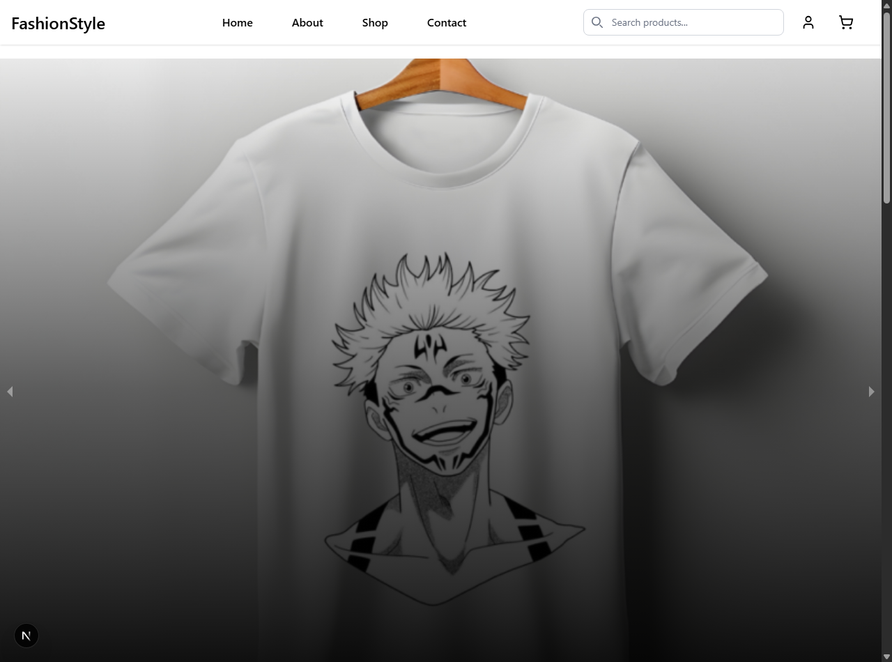
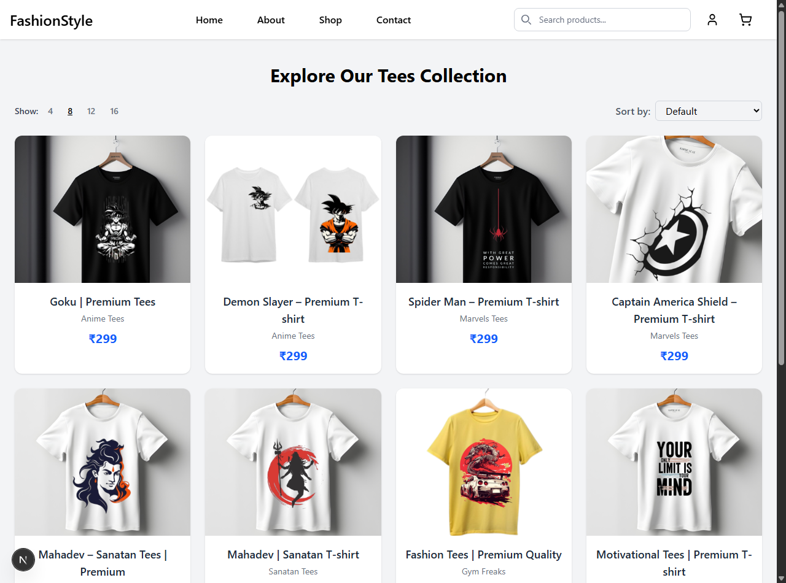
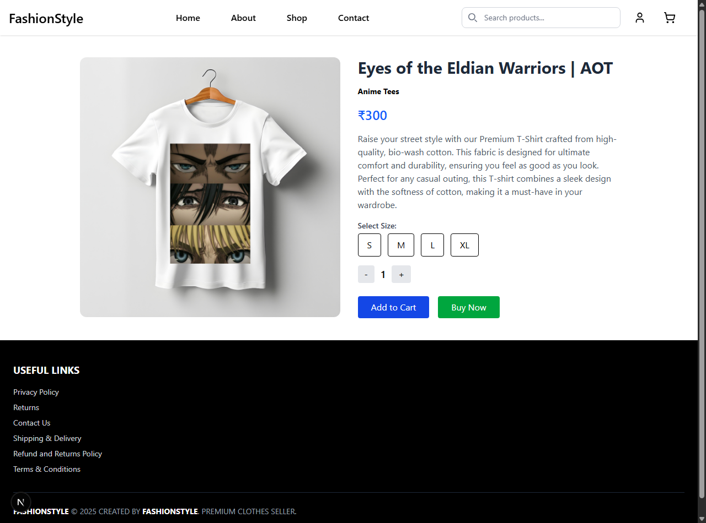
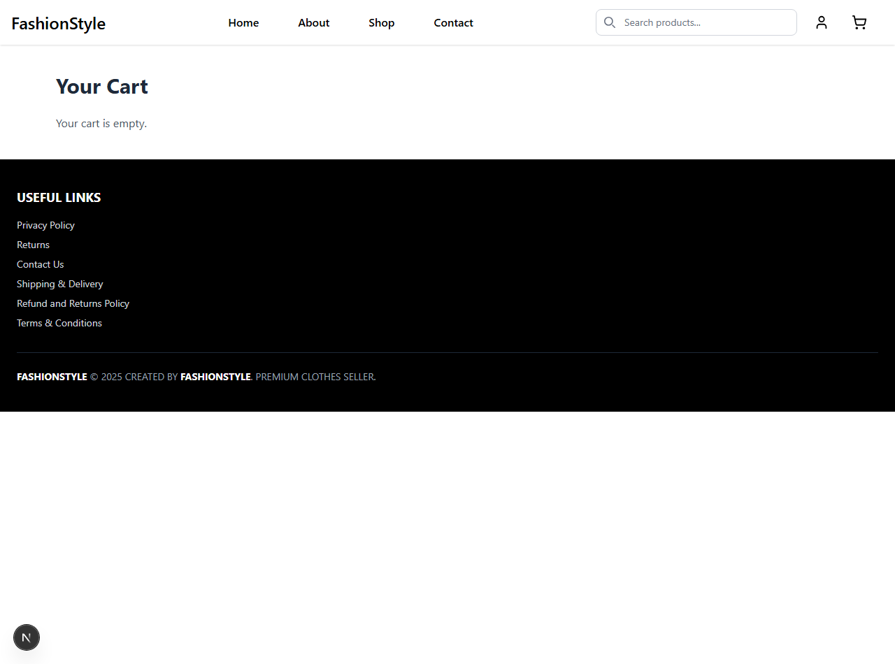
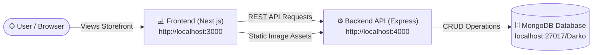

# 🛍️ FashionStyle — Modern MERN & Next.js E-Commerce Platform

[](https://nextjs.org/)
[](https://react.dev/)
[](https://tailwindcss.com/)
[](https://nodejs.org/)
[](https://expressjs.com/)
[](https://www.mongodb.com/)
[](https://redux-toolkit.js.org/)

A full-stack, responsive e-commerce web application built with **Next.js 15**, **Express.js**, and **MongoDB**. Features a dynamic catalog with server-side pagination, category navigation, real-time search, cart management, and an administrative dashboard.

---

## 📸 Website Previews

### 1. 🏠 Homepage & Hero Banners
> Clean hero carousel showcasing the latest drops, summer sales, and trending collections.


---

### 2. 👕 Shop Catalog & Working Pagination
> Grid catalog with interactive page numbers (`< 1 2 >`), dynamic "Show count" selector, and multi-criteria sorting.


---

### 3. 🔍 Single Product Details & Size Selector
> Detailed product view with high-res imagery, size selector (`S`, `M`, `L`, `XL`), quantity controls, and instant "Add to Cart" or "Buy Now".


---

### 4. 🛒 Shopping Cart & Order Summary
> Real-time cart state management displaying selected sizes, quantities, and automatic price tally.


---

## 🏛️ System Architecture & Port Mapping



| Application | Technology | Port | Purpose |
| :--- | :--- | :--- | :--- |
| **Frontend Client** | Next.js 15, React 19, Tailwind CSS | `http://localhost:3000` | User storefront, catalog, cart, checkout |
| **Backend API** | Node.js, Express, Multer, Mongoose | `http://localhost:4000` | REST API, image uploads, authentication |
| **Database** | MongoDB | `mongodb://localhost:27017` | Persistent data storage |

---

## 🚀 How to Run the Project (Step-by-Step)

### Prerequisites
Make sure you have installed on your computer:
- [Node.js](https://nodejs.org/) (v18 or higher recommended)
- [MongoDB](https://www.mongodb.com/try/download/community) running locally on port `27017`
- [Git](https://git-scm.com/)

---

### Step 1: Clone the Repository
```bash
git clone https://github.com/NehaGupta2002/fashion-style-ecommerce.git
cd fashion-style-ecommerce
```

---

### Step 2: Start Backend (Port 4000)
Open a terminal in the root directory:
```bash
# 1. Navigate to backend directory
cd backend

# 2. Install dependencies
npm install

# 3. Create .env file
# Copy .env.example to .env or create one with:
# PORT=4000
# MONGO_URI=mongodb://localhost:27017/Darko
# JWT_SECRET=fashionstyle2025

# 4. Start backend server
npm run server
```
✅ Backend will start and listen at **`http://localhost:4000`**

---

### Step 3: Start Frontend (Port 3000)
Open a **second terminal** window:
```bash
# 1. Navigate to frontend directory
cd frontend

# 2. Install dependencies
npm install

# 3. Start Next.js development server
npm run dev
```
✅ Frontend will start at **`http://localhost:3000`**

---

### Step 4: Open Website
Open your browser and visit:
👉 **[http://localhost:3000](http://localhost:3000)**

---

## 📁 Repository Structure

```
fashion-style-ecommerce/
├── backend/                  # Express REST API Server (Port 4000)
│   ├── controller/           # Business logic (products, categories, orders, banners)
│   ├── middleware/           # JWT Authentication & Authorization
│   ├── model/                # Mongoose database models
│   ├── route/                # API route definitions
│   ├── uploads/              # Uploaded product and banner images
│   ├── .env.example          # Sample environment variables
│   ├── index.js              # Server entry point
│   └── package.json
│
├── frontend/                 # Next.js 15 Client Application (Port 3000)
│   ├── public/               # Public static assets & images
│   ├── src/
│   │   ├── app/              # Next.js App Router (shop, about, cart, products, admin)
│   │   ├── components/       # Reusable React components (Header, Banner, Category)
│   │   └── toolkit/          # Redux Toolkit store, slices, and actions
│   ├── next.config.mjs       # Next.js configuration
│   ├── tailwind.config.js    # Tailwind styling config
│   └── package.json
│
├── screenshots/              # Website preview images showcased in README
│   ├── home.png
│   ├── shop.png
│   ├── product.png
│   └── cart.png
│
├── .gitignore                # Global ignore rules (node_modules, .env, .next)
└── README.md                 # Project documentation
```

---

## ✨ Features

- 🎯 **Interactive Product Catalog**: Multi-page pagination (`< 1 2 >`), sorting by price / latest / rating.
- 🔢 **Custom Page Sizing**: Switch display density (4, 8, 12, 16 items per page).
- 🔎 **Real-time Search**: Search products dynamically from the top navbar.
- 🏷️ **Category Filtering**: Quick access to Anime, Marvel, Sanatan, Gym Freaks, and Plain tees.
- 🛍️ **Shopping Cart & Checkout**: Add items, choose sizes (`S`, `M`, `L`, `XL`), adjust quantities.
- 📌 **Sticky Header**: Seamless navigation with sticky top navbar and live cart badges.
- 🛠️ **Admin Management**: Dedicated admin portal to create, update, and manage products and categories.

---

## 📡 REST API Reference

| Method | Endpoint | Description |
| :--- | :--- | :--- |
| `GET` | `/api/products` | Fetch paginated products with filter & sort |
| `GET` | `/api/products/:id` | Fetch single product by ID |
| `POST` | `/api/products` | Create product (with Multer image upload) |
| `PUT` | `/api/products/:id` | Update existing product |
| `DELETE` | `/api/products/:id` | Remove product and its image |
| `GET` | `/api/categories` | Retrieve all categories |
| `GET` | `/api/banners` | Retrieve active hero banners |
| `POST` | `/api/orders` | Place a customer order |

---

## 👩‍💻 Author

**Neha Gupta**  
- GitHub: [@NehaGupta2002](https://github.com/NehaGupta2002)  
- Email: nehagupta296092@gmail.com
